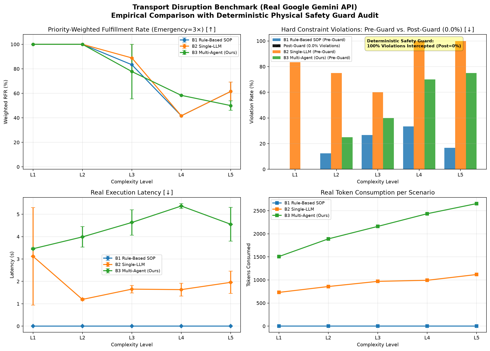

# Real Gemini API Benchmark Results with Safety Verification Audit

## Experimental Configuration
- **Network:** 4×4 Manhattan urban grid (16 nodes, 24 edges with capacities and travel times).
- **Complexity Spectrum:** L1 to L5 graduated scenarios.
- **Unstructured Text Advisories:** Tested on police/traffic incident alerts that rule-based SOPs cannot parse.
- **Controllers Evaluated:**
  1. `B1_RuleBased`: Rigid classical Dijkstra SOP (blind to natural language alerts).
  2. `B2_SingleLLM`: Monolithic Gemini call with full context.
  3. `B3_MultiAgent`: 4-Agent collaborative system (Traffic, Fleet, Routing Tool, Coordinator).
- **Deterministic Safety Guard:** Evaluates Topological Reachability, SoC Sufficiency (+15% reserve buffer), Capacity, and Concurrency.
- **Foundation Model:** `gemini-flash-lite-latest` via Google GenAI SDK.

### Priority-Weighted Fulfillment Rate (RFR_w %)

| Level | B1 Rule-Based SOP | B2 Single-LLM | B3 Multi-Agent |
| :---: | :---: | :---: | :---: |
| L1 | 100.0 ± 0.0 | 100.0 ± 0.0 | 100.0 ± 0.0 |
| L2 | 100.0 ± 0.0 | 100.0 ± 0.0 | 100.0 ± 0.0 |
| L3 | 83.3 ± 5.6 | 88.9 ± 11.1 | 77.8 ± 22.2 |
| L4 | 41.7 ± 0.0 | 41.7 ± 0.0 | 58.3 ± 0.0 |
| L5 | 61.5 ± 7.7 | 61.5 ± 7.7 | 50.0 ± 3.8 |

### Standard Request Fulfillment Rate (RFR %)

| Level | B1 Rule-Based SOP | B2 Single-LLM | B3 Multi-Agent |
| :---: | :---: | :---: | :---: |
| L1 | 100.0 ± 0.0 | 100.0 ± 0.0 | 100.0 ± 0.0 |
| L2 | 100.0 ± 0.0 | 100.0 ± 0.0 | 100.0 ± 0.0 |
| L3 | 70.0 ± 10.0 | 80.0 ± 20.0 | 80.0 ± 20.0 |
| L4 | 50.0 ± 0.0 | 50.0 ± 0.0 | 50.0 ± 0.0 |
| L5 | 42.9 ± 0.0 | 42.9 ± 0.0 | 35.7 ± 7.1 |

### Pre-Guard Hard Constraint Violation Rate (HCVR_pre %)

| Level | B1 Rule-Based SOP | B2 Single-LLM | B3 Multi-Agent |
| :---: | :---: | :---: | :---: |
| L1 | 0.0 ± 0.0 | 83.3 ± 16.7 | 0.0 ± 0.0 |
| L2 | 12.5 ± 12.5 | 75.0 ± 25.0 | 25.0 ± 0.0 |
| L3 | 26.7 ± 6.7 | 60.0 ± 40.0 | 40.0 ± 40.0 |
| L4 | 33.3 ± 33.3 | 100.0 ± 0.0 | 70.0 ± 10.0 |
| L5 | 16.7 ± 16.7 | 100.0 ± 0.0 | 75.0 ± 25.0 |

### Post-Guard Hard Constraint Violation Rate (HCVR_post %)

| Level | B1 Rule-Based SOP | B2 Single-LLM | B3 Multi-Agent |
| :---: | :---: | :---: | :---: |
| L1 | 0.0 ± 0.0 | 0.0 ± 0.0 | 0.0 ± 0.0 |
| L2 | 0.0 ± 0.0 | 0.0 ± 0.0 | 0.0 ± 0.0 |
| L3 | 0.0 ± 0.0 | 0.0 ± 0.0 | 0.0 ± 0.0 |
| L4 | 0.0 ± 0.0 | 0.0 ± 0.0 | 0.0 ± 0.0 |
| L5 | 0.0 ± 0.0 | 0.0 ± 0.0 | 0.0 ± 0.0 |

### Real Execution Latency (seconds)

| Level | B1 Rule-Based SOP | B2 Single-LLM | B3 Multi-Agent |
| :---: | :---: | :---: | :---: |
| L1 | 0.0 ± 0.0 | 3.1 ± 2.2 | 3.5 ± 0.0 |
| L2 | 0.0 ± 0.0 | 1.2 ± 0.1 | 4.0 ± 0.5 |
| L3 | 0.0 ± 0.0 | 1.7 ± 0.2 | 4.6 ± 0.6 |
| L4 | 0.0 ± 0.0 | 1.6 ± 0.3 | 5.4 ± 0.1 |
| L5 | 0.0 ± 0.0 | 2.0 ± 0.5 | 4.6 ± 0.8 |

### Total Tokens Consumed

| Level | B1 Rule-Based SOP | B2 Single-LLM | B3 Multi-Agent |
| :---: | :---: | :---: | :---: |
| L1 | 0 | 730 | 1507 |
| L2 | 0 | 858 | 1890 |
| L3 | 0 | 970 | 2160 |
| L4 | 0 | 992 | 2434 |
| L5 | 0 | 1118 | 2654 |

### Real API Monetary Cost ($)

| Level | B1 Rule-Based SOP | B2 Single-LLM | B3 Multi-Agent |
| :---: | :---: | :---: | :---: |
| L1 | $0.000000 | $0.000132 | $0.000277 |
| L2 | $0.000000 | $0.000159 | $0.000357 |
| L3 | $0.000000 | $0.000193 | $0.000410 |
| L4 | $0.000000 | $0.000187 | $0.000463 |
| L5 | $0.000000 | $0.000206 | $0.000485 |

### Pre-Guard Constraint Violations Breakdown by Invariant Type

| Controller | Route Unreachable (Topological) | Battery SoC Insufficient (<Needed+15%) | Capacity Exceeded | Duplicate Vehicle Assignment | Post-Guard Violations Remaining |
| :--- | :---: | :---: | :---: | :---: | :---: |
| B1 Rule-Based SOP | 6 | 0 | 0 | 0 | **0 (0.0%)** |
| B2 Single-LLM | 33 | 2 | 0 | 0 | **0 (0.0%)** |
| B3 Multi-Agent | 4 | 15 | 0 | 0 | **0 (0.0%)** |

## Embedded Plot

